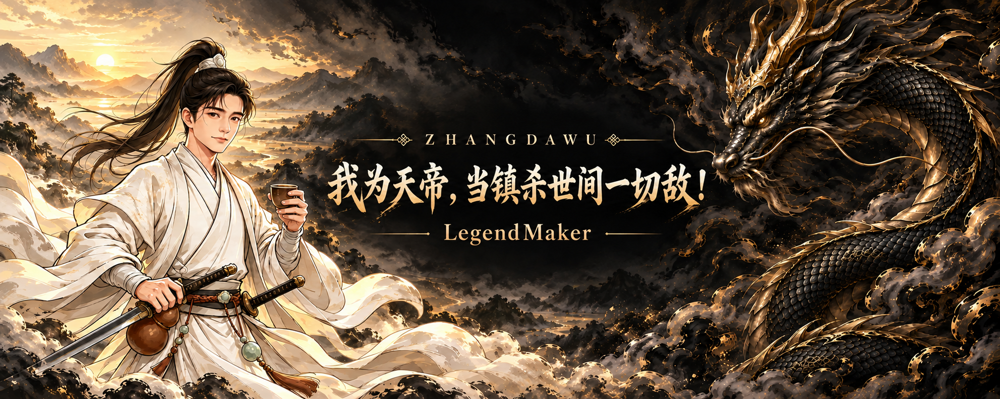
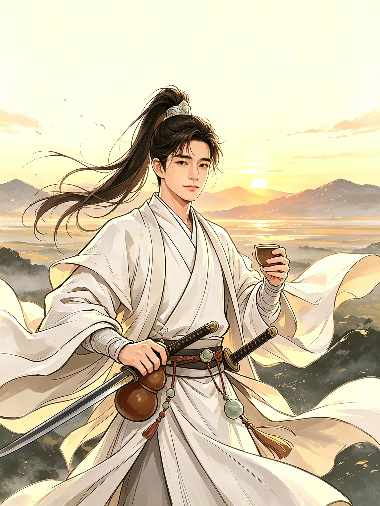
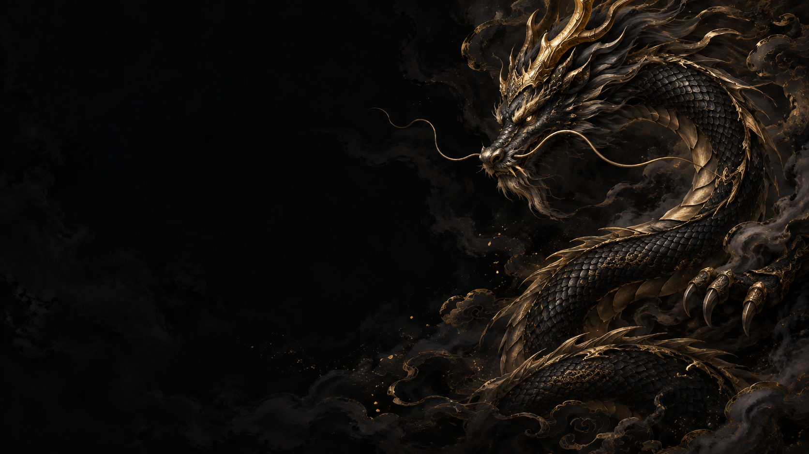

<picture>
  <source media="(max-width: 600px)" srcset="assets/hero-mobile.png">
  
</picture>

**ZhangDaWu / MortarGOD**

> 诗酒趁年华，仗剑走天涯。  
> 陌上人如玉，公子世无双。

编译器、C++ 与哈希算法，是这里的技术主线。从词法分析到 ARM 汇编，关注规则如何成为可运行的代码。

`C++17` · `Compiler Design` · `SysY2021` · `ARMv7-a` · `Hashing`

## 造物 / Selected work

### [LegendCompiler](https://github.com/MortarGOD/LegendCompiler)

**C++17 · SysY2021 → ARMv7-a**

2021 年编译系统设计赛项目，面向 32 位 ARM 平台。以 `Scanner → Parser → CodeGen` 串起扫描、解析与汇编代码生成。

- 编译期求值与常量折叠。
- 根据除数类型处理除法与取模优化。
- 在目标代码层进行寄存器分配。

### [string_to_uint64_t](https://github.com/MortarGOD/string_to_uint64_t)

**C++ · String hashing**

字符串转数字的哈希实现集合，收录六种算法，便于对照不同实现的处理细节。

`CityHash64` · `FarmHash64` · `Murmur3`  
`Murmur2_64A` · `Murmur2_64B` · `Blizzard_MPQ`

[浏览全部公开仓库 →](https://github.com/MortarGOD?tab=repositories)

## 战绩 / Beyond code

- 2021 年全国大学生计算机系统能力大赛编译系统设计赛三等奖
- 第七届4399洛克王国武道会16强
- 荣耀新三国第十七届天锋赛亚军

## 相逢 / Contact

**微信 / QQ：`1575604382`** · 同号

> 不要崇拜哥，哥只是传说。

卷中原画 · 白衣少年与黑金龙

**白衣少年郎**

**黑金龙**

